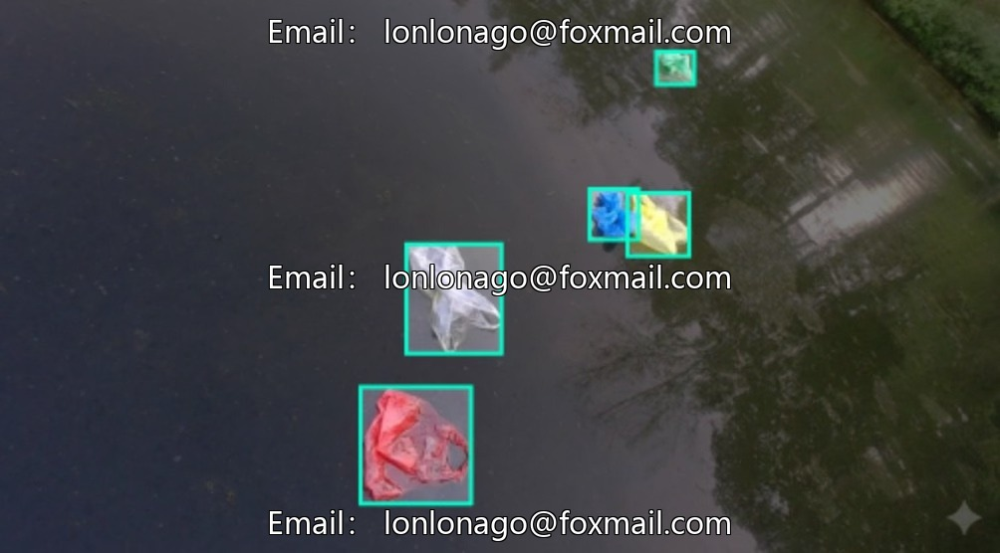
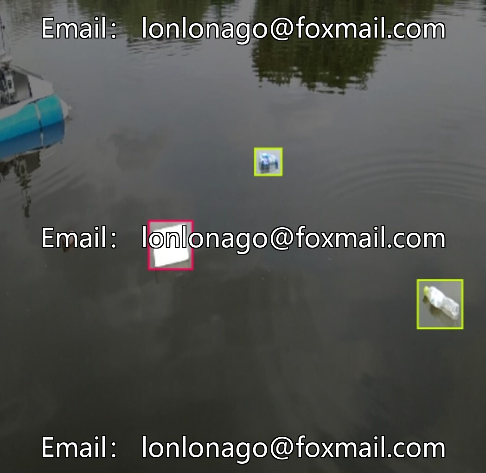
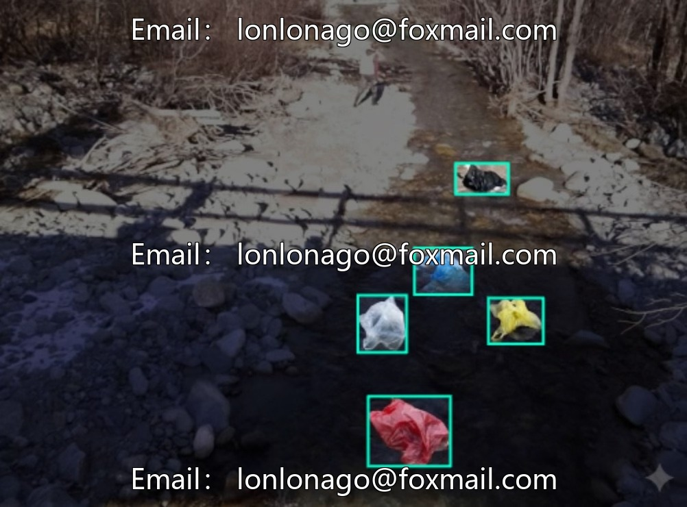

# Urban governance river channel pollution identification drone inspection dataset, plastic tape, bottle, branch, can

## Body

Urban River Pollution Detection Drone Survey Data Set, including images of 6 types of waste such as plastic bags, bottles, branches, cans, milk cartons, and plastic bags, totaling 2200 entries in YOLO format, suitable for garbage recognition model training.

Data covers common outdoor waste, with clear annotations. Supports intelligent waste sorting systems and optimizes environmental monitoring algorithms. Also suitable for research on visual environments in scientific research.

Virtual materials, once sold, are non-refundable.
Interested friends, click "I want" to proceed.

## Images

## Payment

Here is a pay link on Stripe ( https://buy.stripe.com/3cs8yP7sY87d0vu9AB ). Please contact me lonlonago@foxmail.com after funding $89, and I will send you a complete data files , thank you!

